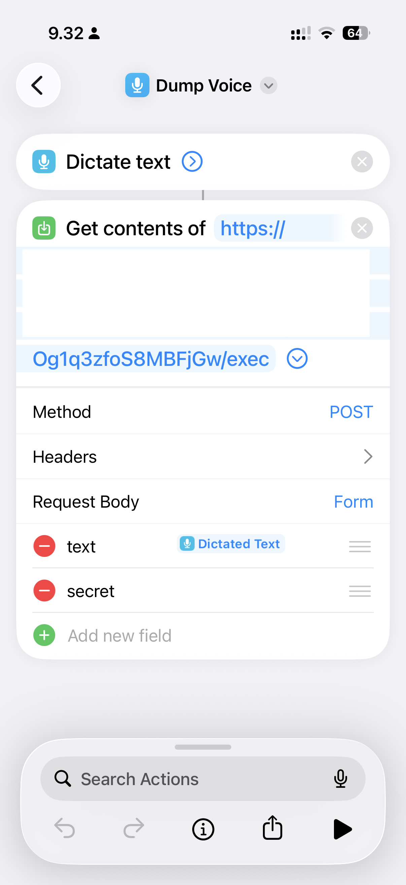

The stock iOS notes app has been my go-to "brain dump" tool for a while. I like the fact that I can use the Share extension from more or less any context and save an image, link, web page and whatnot in a new note. The only thing I don't like about it is that I need to categorize the note when I create it, and the UI to do it is cumbersome.

I've been thinking about creating a replacement that works in the exact same way, but uses AI to classify the note in the background. To validate the idea, I put together a duct-and-tape equivalent that actually works surprisingly well and may end up being the Final Solution.

As the storage system for my notes I chose a single Google Doc named "Brain Dump". I like to use Google Docs for this type of applications because it's easy to read and modify by hand later. Also, Google Docs has a comprehensive API and ready integrations with any AI tool, in my case Claude. This is important because I would like my LLM to be aware of my notes when I'm chatting with it (more on this later).

The backend is handled by a Google App Script that receives the note content, uses Gemini to classify it and appends it to the Google Doc. Anybody can ask an AI to create this script in seconds like I did, so I don't know what's the point in sharing it, but here it is:

```
const DOC_ID = <from the doc URL>
const MODEL  = 'gemini-flash-latest';

const PROPS  = PropertiesService.getScriptProperties();
const SECRET = PROPS.getProperty('SHARED_SECRET');

const VERSION = 'v3-link';

function doPost(e) {
  const params = e.parameter.text ? e.parameter : JSON.parse(e.postData.contents || '{}');
  if (params.secret !== SECRET) return ContentService.createTextOutput('forbidden');
  const text = (params.text || '').trim();
  if (!text) return ContentService.createTextOutput('empty');

  console.log('VERSION=' + VERSION + ' text=' + text);

  const urlMatch = text.match(/https?:\/\/\S+/);
  console.log('urlMatch=' + (urlMatch ? urlMatch[0] : 'none'));

  const date = Utilities.formatDate(new Date(), 'Europe/Helsinki', 'yyyy-MM-dd');
  let line, branch, why = '';
  try {
    if (urlMatch) {
      const page = fetchPageText(urlMatch[0]);
      console.log('fetched ' + page.title + ' (' + page.text.length + ' chars)');
      const meta = enrichLink(text, urlMatch[0], page);
      branch = 'LINK';
      line = `[${(meta.tags || []).join(', ')}] ${meta.title} — ${meta.summary} — ${text}`;
    } else {
      const meta = enrich(text);
      branch = 'TEXT';
      line = `[${(meta.tags || []).join(', ')}] ${text}`;
    }
  } catch (err) {
    why = ' err=' + err.message;
    try {
      const meta = enrich(text);
      branch = 'TEXT-FALLBACK';
      line = `[${(meta.tags || []).join(', ')}] ${text}`;
    } catch (e2) {
      why += ' | ' + e2.message;
      branch = 'RAW';
      line = text;
    }
  }

  console.log('branch=' + branch);

  const body = DocumentApp.openById(DOC_ID).getBody();
  const para = body.appendParagraph(`${date} ⟨${branch}${why}⟩ ${line}`);
  const t = para.editAsText();
  t.setBold(false);
  t.setBold(0, date.length - 1, true);
  const spacer = body.appendParagraph('');
  spacer.setAttributes({ [DocumentApp.Attribute.BOLD]: false });

  return ContentService.createTextOutput('ok');
}

function enrich(text) {
  const key = PROPS.getProperty('GEMINI_API_KEY');
  const url = `https://generativelanguage.googleapis.com/v1beta/models/${MODEL}:generateContent?key=${key}`;

  const prompt =
    'Classify this personal note. The user is an Italian engineering manager in Helsinki; ' +
    'notes may be in English, Italian, or Finnish. Return ONLY JSON, no markdown:\n' +
    '{"summary":"one concise line in English, max 120 chars",' +
    '"tags":["1-4 kebab-case tags"],' +
    '"language":"ISO code of the note\'s language (en/it/fi/...)"}\n\n' +
    'Note:\n"""\n' + text + '\n"""';

  return callGemini(prompt);
}

function enrichLink(note, url, page) {
  const prompt =
    'Summarize and classify a web page the user saved to their notes. ' +
    'The user is an Italian engineering manager in Helsinki. Return ONLY JSON:\n' +
    '{"title":"the page title, cleaned up, max 80 chars",' +
    '"summary":"2-3 sentences on what the page says, in English",' +
    '"tags":["1-4 kebab-case tags"]}\n\n' +
    "User's own note (may be empty): " + note + '\n' +
    'URL: ' + url + '\nPage title: ' + page.title + '\n' +
    'Page text:\n"""\n' + page.text + '\n"""';
  return callGemini(prompt);   // factor the fetch/parse out of enrich() into callGemini()
}

function fetchPageText(url) {
  const res = UrlFetchApp.fetch(url, {
    muteHttpExceptions: true,
    followRedirects: true,
    headers: { 'User-Agent': 'Mozilla/5.0 (compatible; BrainDump/1.0)' }
  });
  if (res.getResponseCode() !== 200) throw new Error('fetch ' + res.getResponseCode());

  const type = res.getHeaders()['Content-Type'] || '';
  if (type.indexOf('text/html') === -1) throw new Error('not html: ' + type);

  const html = res.getContentText();
  const title = (html.match(/<title[^>]*>([\s\S]*?)<\/title>/i) || [])[1] || '';
  const text = html
    .replace(/<script[\s\S]*?<\/script>/gi, ' ')
    .replace(/<style[\s\S]*?<\/style>/gi, ' ')
    .replace(/<[^>]+>/g, ' ')
    .replace(/&nbsp;/g, ' ').replace(/&amp;/g, '&')
    .replace(/&quot;/g, '"').replace(/&#39;/g, "'")
    .replace(/&lt;/g, '<').replace(/&gt;/g, '>')
    .replace(/\s+/g, ' ')
    .trim();

  return { title: title.trim(), text: text.slice(0, 8000) };
}

function callGemini(prompt, useUrlContext) {
  const key = PROPS.getProperty('GEMINI_API_KEY');
  const url = `https://generativelanguage.googleapis.com/v1beta/models/${MODEL}:generateContent`;

  const payload = {
    contents: [{ parts: [{ text: prompt }] }],
    generationConfig: { temperature: 0.2, responseMimeType: 'application/json' }
  };
  if (useUrlContext) {
    payload.tools = [{ url_context: {} }];
    delete payload.generationConfig.responseMimeType;   // tools + JSON mode can conflict
  }

  const res = UrlFetchApp.fetch(url, {
    method: 'post',
    contentType: 'application/json',
    muteHttpExceptions: true,
    headers: { 'x-goog-api-key': key },
    payload: JSON.stringify(payload)
  });

  if (res.getResponseCode() !== 200) {
    throw new Error('gemini ' + res.getResponseCode() + ': ' + res.getContentText().slice(0, 200));
  }
  const body = JSON.parse(res.getContentText());
  const jsonText = body.candidates[0].content.parts[0].text;
  return JSON.parse(jsonText.replace(/```json|```/g, '').trim());
}
```

It's pretty straightforward, the only thing worth mentioning is that when recording URLs the script looks into the page's content and adds it to the context, asking for a summary. I wasn't able to get logs out of the script so the diagnostic information is appended directly in the document.

On the client side I used Shortcuts, available on iOS, MacOS and WatchOS. I hadn't used Shortcuts before and was pleasantly surprised by their capabilities. It's a visual scripting language that looks simple but is actually quite powerful, for example it can query any URL and parse the response or extract text from an image. I created different shortucts for text input, voice, clipboard and share sheet.

Here is an example of the Shortcut Editor for the "Dump Voice" shortcut:



To make it even more seamless, I have configured this shortcut to respond to "double back tap" (found in the iOS accessibility settings). 

I've been using this system for a few weeks now, and find it very useful. The real missing piece is easy navigation of the notes, the Google Doc is already unwieldy and will become even worse. For that I would need to build a full stack which is the next step now that I have proven that the idea is worthy.