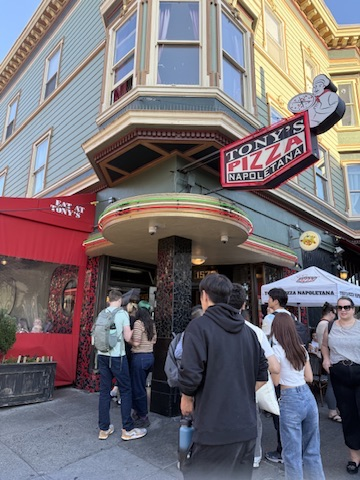
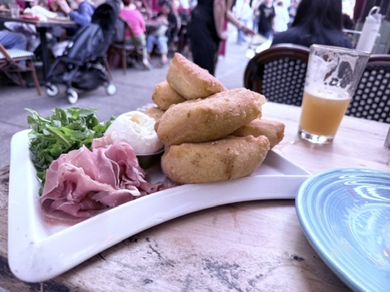
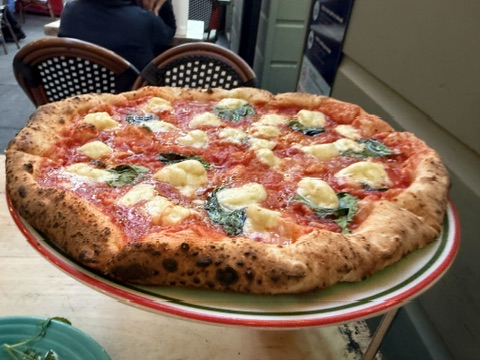
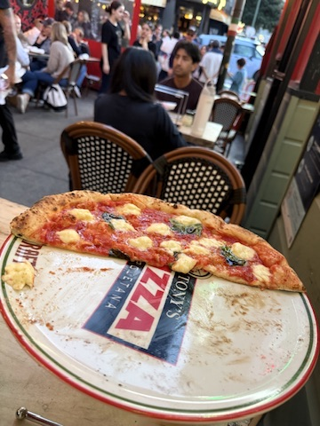
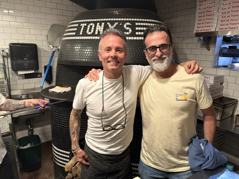

[Tony Gemignani](https://tonygemignani.com) is an American pizzaiolo and 13 times world pizza champion, and also the author of ["The Pizza Bible"](https://a.co/d/0ay186ad), my favorite book about pizza making. A few years ago he opened a restaurant in the North Beach district (i.e. the Italian quarter) of San Francisco and since I was in San Francisco for work, I had to try it. The restaurant is [Tony's Pizza Napoletana](https://tonyspizzanapoletana.com).

The place was crowded and I had to be on the waiting list for almost an hour, but this was well managed through Yelp and text messages. They sat me outside on the street.

 

When looking at [the menu](https://tonyspizzanapoletana.com/menu/#dinner) I was surprised that despite the name, there were only three neapolitan style pizzas: Marinara, Margherita and Capodimonte (dried tomatoes and basil). The most interesting condiments were for different styles of pizzas, many of which served 2-4 people. The Margherita was touted as the "World Pizza Cup" winner in Naples, with only a limited amount available per day, plus it's the litmus test for any pizzeria, so I had to take it. It also cost 30 frigging dollars! At least it made me feel better about the prices in Helsinki. As a starter I took "Coccoli" which I understood from the description, and later confirmed, to be fried dough or what at home we call "panzerotti". 

The Coccoli ended up being the best part of the meal, except that they were huge and would have been enough on their own. They came with burrata and prosciutto.

The pizza was good, but I found the dough a bit too wet for my taste, and the mozzarella was only barely melted which I personally don't like. The tomato sauce was spiced with what tasted like fennel seeds which was a nice touch, but otherwise the pizza was not as remarkable as I expected. I wish I would have tried some of the non-neapolitan style pizzas.

While waiting for my table I had noticed that Tony was in, so after paying the bill I lingered outside until I saw him serving some food and intercepted him to take a photo. He was very nice about it and asked a waitress to take a photo of us in front of the oven. Afterwards I thought about all the clever things I could have asked him, but in the excitement of the moment I could only blurt out "you are great!" to which he gracefully replied "appreciated".

